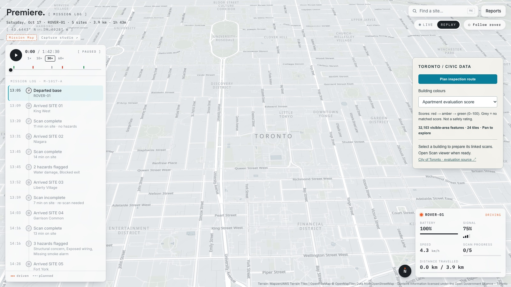
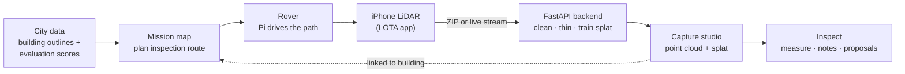

<div align="center">



<br />

# Premiere

**A rover with an iPhone on top drives a route, scans buildings with LiDAR, and turns each scan into a 3D model you can inspect in the browser.**

<br />

[](https://github.com/Vedthakar/HTV11)
[](https://threejs.org)
[](web/)
[](backend/)
[](docs/CAPTURE.md)
[](rover/)

[Quickstart](#quickstart) · [Features](#features) · [How it works](#how-it-works) · [The rover](#the-rover) · [Docs](#documentation) · [Team](#team)

</div>

---

## What is Premiere?

**City building inspections, from a rover instead of a clipboard.**

Premiere plans an inspection route through Toronto from public building data, drives a small rover along it, and scans each stop with an iPhone's LiDAR. The scans land in a 3D studio where an inspector can walk around the point cloud, measure it, pin notes to what they see, and preview a proposed replacement building in place.

It is three pieces that work together:

| Piece | What it does | Built with |
|---|---|---|
| **Mission map** | Picks low-scoring apartment buildings, plans a walking route, and replays the rover's survey with live telemetry | React, TypeScript, MapLibre GL |
| **Capture studio** | Imports LiDAR scans, renders point clouds and Gaussian splats, and adds inspection tools | Three.js, SparkJS, FastAPI, Brush |
| **Rover** | Drives a drawn path from a Raspberry Pi and a Grove I2C motor driver | Python, C, systemd |

---

## Features

**Mission map** (`/`)
- 🗺️ **557,694 Toronto building outlines**, coloured by the City's apartment evaluation score and loaded tile by tile.
- 🧭 **Inspection route planner**: picks the lowest-scoring buildings nearby and routes a walk between them, with GeoJSON export.
- 📡 **Live and replay modes**: a mission log you can scrub, a particle trail behind the rover, and a telemetry card for battery, signal, speed and scan progress.

**Capture studio** (`/studio.html`)
- 📥 **One-drop LiDAR import** from the LOTA iPhone app: it removes pose spikes from bumps, filters floating points, and thins the cloud to 1 cm.
- ✨ **Gaussian splats**: trains a photoreal splat from the same capture with Brush.
- 🎨 **Height colouring and scan-scaled points**, so floors, walls and overhangs read clearly on any size of scan.
- 📏 **Measure**: click two points on the scan to get the distance between them.
- 📌 **Inspection notes** pinned to a 3D point, with a photo from the capture as evidence.
- 🏠 **Proposed building preview**: a configurable house you can move, rotate and compare against the existing scan, with the old building cut out.

**Rover** (`rover/`)
- ✏️ **Draw a path on the laptop** (or pick a circle, figure 8 or square) and preview what the car will actually do.
- 🔌 **Unplug to drive**: the Pi stores the mission and starts it a few seconds after the cable comes out.
- 🔧 **Calibration tools** for steering, speed and the motor's minimum power, plus a point-turn for tight spaces.

---

## How it works



1. **Plan.** The mission map scores buildings from City of Toronto data and routes a walk to the ones that need attention first.
2. **Drive.** The rover's path planner turns a drawn path into steering and throttle commands at 50 Hz, then drives it open-loop when the tether is pulled.
3. **Scan.** An iPhone on the rover records RGB, LiDAR depth and camera poses with LOTA, as a ZIP or as a live point stream.
4. **Process.** The backend cleans and thins the cloud and can train a Gaussian splat with Brush.
5. **Inspect.** The studio loads the result for measuring, notes and design proposals, linked back to the building on the map.

---

## Quickstart

You need **Python 3.12+** and **Node 22+**. Works on macOS and Windows.

```bash
git clone https://github.com/Vedthakar/HTV11.git
cd HTV11
npm run setup        # Python venv, backend packages, web packages
```

Then, in two terminals:

```bash
npm run backend      # API on http://127.0.0.1:8008 (docs at /docs)
npm run dev          # web app on http://127.0.0.1:5175
```

Open **http://127.0.0.1:5175** for the mission map and **http://127.0.0.1:5175/studio.html** for the capture studio.

No phone yet? Load test data:

```bash
npm run fixtures     # synthetic LOTA captures in data/lota_fixtures/
npm run demo         # a synthetic capture session in the studio
```

Both are clearly labelled **SYNTHETIC** in the UI so they're never mistaken for a real scan.

---

## The rover

The car runs from `rover/`: a Raspberry Pi with a Grove I2C motor driver, one rear drive motor and front steering.

```bash
# On your laptop: the path drawing page
cd rover/mac && python3 server.py              # http://localhost:8000

# On the Pi: install the path runner as a service
cd ~/rover/pi && bash install.sh && sudo reboot
```

Draw a path, upload it, unplug the cable, and the car drives it. Wiring, calibration and the standalone C straight-drive program are covered in **[rover/README.md](rover/README.md)**.

> [!NOTE]
> The drive is open-loop dead reckoning: it doesn't avoid obstacles or use the LiDAR to correct itself. Calibrate on the floor you'll drive on, since smooth floors cause the car to understeer.

---

## Documentation

| Guide | Covers |
|---|---|
| [docs/CAPTURE.md](docs/CAPTURE.md) | Scanning with LOTA, live preview, the legacy RoverCapture iPhone app, capture format |
| [docs/STUDIO.md](docs/STUDIO.md) | Viewer tools, inspection notes, proposed buildings, Gaussian splats |
| [docs/MISSION_MAP.md](docs/MISSION_MAP.md) | Mission map, telemetry WebSocket protocol, Toronto data and route planning |
| [rover/README.md](rover/README.md) | Rover wiring, install, calibration, path upload |
| [VERIFICATION.md](VERIFICATION.md) | What has been tested and how |

---

## Project structure

```
web/                React mission map + Three.js capture studio (Vite)
  src/mission/      telemetry sources, playback store, mission events
  src/map/          MapLibre controller, basemap restyle, particle trail
  src/main.js       studio: point cloud and splat rendering
backend/            FastAPI: sessions, LOTA import, live stream, notes, splat training
rover/              path planner, Pi motor server, calibration, Mac drawing UI, C drive
ios/RoverCapture/   legacy SwiftUI + ARKit capture app
scripts/            city data preparation, fixtures, Brush installer
tests/              Python pipeline and API tests
```

## Tests

```bash
npm test             # Python backend tests + web unit tests
npm run typecheck
npm run build
cd rover && python3 tests/test_planner.py && python3 tests/test_unplug.py
```

---

## Limitations

- **Scans are visual, not surveyed.** Point clouds are capped at 200,000 points and aren't certified measurements. An observation records what's visible; it isn't a structural safety assessment.
- **Route playback is simulated** until a rover connects to the telemetry socket. Routes use pedestrian walking directions, so rover clearance and entrances aren't checked.
- **The rover drives open-loop.** No obstacle avoidance, wheel odometry or gyro yet.
- **Evaluation scores** come from the City's published dataset, not a live feed.

---

## Team

Built at **Hack the Valley 11**, where it won.

| | Highlights |
|---|---|
| **Maggie Wu** ([@magi-wuu](https://github.com/magi-wuu)) | iPhone LiDAR capture and the 3D reconstruction studio; proposed buildings, placement and replacement regions |
| **Kevin Pogoryelovskyy** ([@KelvinPogo](https://github.com/KelvinPogo)) | Mission map and dashboard, LOTA importer, live preview, map features |
| **Ved Thakar** ([@Vedthakar](https://github.com/Vedthakar)) | Rover drive software: path planner, Pi motor server, calibration and the C drive program; LiDAR viewer tools (height colouring, measure) |
| **Vedant Kansara** ([@vedantkminiai](https://github.com/vedantkminiai)) | Custom rover hardware assembly and integration; repurposed and disassembled an RC robot, wired Raspberry Pi 4B, motor controller, DC motors and battery pack; programmed robot movement using Python |

## Data and credits

City data: [Toronto Topographic Mapping, Building Outlines](https://open.toronto.ca/dataset/topographic-mapping-building-outlines/) and [Apartment Building Evaluations](https://open.toronto.ca/dataset/apartment-building-evaluation/). Contains information licensed under the [Open Government Licence – Toronto](https://open.toronto.ca/open-data-licence/). Basemap by [OpenFreeMap](https://openfreemap.org) and © OpenStreetMap contributors. Routing by FOSSGIS / OSRM. Rendering by [Three.js](https://threejs.org), [SparkJS](https://sparkjs.dev) and [Brush](https://github.com/ArthurBrussee/brush). Capture with LOTA (LiDAR Over the Air) and Apple ARKit.
